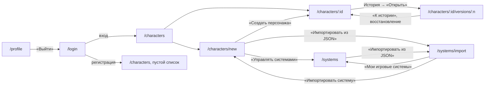

# UI/UX DiceBound

Документ описывает интерфейс DiceBound MVP: экраны, маршруты, компоненты,
состояния элементов, тексты и правила адаптивности.
Он нужен frontend-команде, чтобы реализовать интерфейс по утверждённому
дизайну без обращения к макетам за недостающими деталями.
Scope продукта описан в [DiceBound MVP](./mvp-scope.md),
HTTP API — в [технических контрактах](./technical-contracts.md),
формат схемы — в [SheetSchema and Character Data](./data-model/sheet-schema.md).

> Status: Active

## Источник дизайна

Макеты находятся на холсте [DiceBound — MVP дизайн][figma].
При расхождении этого документа и холста верен холст.
Формат `Sheet Schema` и API задают контрактные документы:
если холст им противоречит, исправляется холст.
Расхождение дизайна с [DiceBound MVP](./mvp-scope.md) исправляется в дизайне.

Холст разделён на четыре страницы.

- «Основной дизайн» — экраны desktop 1280 px, телефон 390 px, планшет 768 px,
  справочные доски `FieldKit`, `States`, `Responsive`.
- «Состояния» — доски `State-*`: варианты экранов после действий
  пользователя и ошибок.
- «UI-kit» — `UIKit-Foundations`, `UIKit-Controls`, `UIKit-Feedback`,
  `UIKit-Icons`, `UIKit-States`.
  Доска `UIKit-States` закрывает pressed, загрузку, недоступные поля, движение
  и фиксирует одно значение там, где другие доски расходились.
- «Вайрфреймы» — доски `WF-*`, исторические.
  Для реализации не используются.

Доски страницы «Основной дизайн» сгруппированы по рядам.

- Вход и список персонажей — `Main`, `Characters`, `CharactersEmpty`,
  `DeleteConfirm`.
- Создание персонажа и динамический лист — `Create`, `SheetDnD`, `SheetCoC`.
- История версий и восстановление — `History`, `Version`, `RestoreConfirm`.
- Доступ `VIEW` / `EDIT` — `Access`, `ShareAdd`, `SheetView`.
- Импорт НРИ и профиль — `Import`, `ImportError`, `Profile`, `Systems`.
- `EDIT`-копия, renderer и системные состояния — `SheetCopy`, `FieldKit`,
  `States`.
- Адаптивность, телефон — `Responsive`, `MLogin`, `MCharacters`, `MCreate`,
  `MSheetDnD`, `MHistory`, `MVersion`, `MAccess`, `MShareAdd`, `MImport`,
  `MSystems`.
- Адаптивность, планшет — `TCharacters`, `TSheetDnD`, `TCreate`, `TAccess`,
  `TImport`.

## Принципы UI/UX

**Лист не рисуется под НРИ.**
Любой лист собирает один компонент `Dynamic Sheet Renderer` из `Sheet Schema`
и данных персонажа.
D&D 5e, Call of Cthulhu и импортированная Custom System на холсте построены из
одних и тех же шести типов полей.

**Один renderer для всех режимов.**
Редактирование, просмотр старой версии, лист получателя `VIEW` и предпросмотр
импорта используют тот же renderer.
Режим read-only включается флагом, а не отдельным компонентом.

**Необратимое действие называет последствие.**
Восстановление версии, выдача `EDIT`, удаление персонажа, удаление системы и
отзыв `VIEW` требуют подтверждения.
Кнопка подтверждения описывает результат, например
«Восстановить и удалить 3 версии», а не «ОК».

**Вычисляемое видно сразу.**
Фиолетовый используется для `calculated`-полей, формул, фокуса и
информационных баннеров.
Пользователь отличает вычисляемое значение от редактируемого без чтения
подписей.

**Интерфейс не раскрывает чужие данные.**
Ошибки выдачи доступа, регистрации и недоступного персонажа не сообщают,
существует ли аккаунт или чужой персонаж.

**В интерфейсе нет функций вне MVP.**
Функции, исключённые из MVP, не появляются даже как заглушка «скоро».

## Визуальное направление

Интерфейс использует тёмную тему со спокойной «настольной» атмосферой.
Crimson — акцент действий.
Фиолетовый — маркер вычисляемых значений и фокуса.
Зелёный обозначает успешное состояние.

### Цвета

Имена токенов взяты с доски `UIKit-Foundations` и используются в коде как
CSS-переменные.

| Токен | Значение | Применение |
| --- | --- | --- |
| `bg/canvas` | `#0b0b0f` | Фон вокруг приложения |
| `bg/app` | `#0e0e12` | Основной фон |
| `bg/sidebar` | `#121218` | Боковая панель, верхняя панель телефона |
| `surface/card` | `#17171f` | Карточки, модальные окна |
| `surface/sunken` | `#15151c` | Read-only поля, пары, недоступные поля |
| `surface/field` | `#1e1e28` | Поля, кнопки, чипы |
| `surface/hover` | `#282836` | Hover кнопок, трек полос |
| `surface/code` | `#101016` | Редактор JSON |
| `overlay` | `rgba(9,9,12,.74)` | Затемнение под модальными окнами |
| `border/default` | `#2a2a37` | Границы карточек |
| `border/strong` | `#3b3b4e` | Границы полей и кнопок |
| `border/divider` | `#23232e` | Разделители строк |
| `text/primary` | `#ece8e2` | Основной текст |
| `text/readonly` | `#d8d4de` | Значения read-only |
| `text/secondary` | `#b9b6c2` | Второстепенный текст, навигация |
| `text/muted` | `#8b8899` | Подписи, метаданные |
| `text/faint` | `#6f6c7e` | Диапазоны `min–max`, плейсхолдер |
| `code/gutter` | `#4a4a60` | Номера строк, hover-граница полей |
| `accent/crimson` | `#c93450 → #b02a40` | Primary, активная вкладка |
| `accent/crimson-light` | `#ea6a7e` | Ошибки, изменённые поля |
| `calc/violet` | `#9a8fe6` | `calculated`, обводка фокуса |
| `calc/violet-light` | `#b3aaf0`, `#c9c2f7` | Значения `calculated` |
| `ok/green` | `#6dbf95`, `#8fd4b0` | Сохранено, схема корректна |
| `code/number` | `#e6c07b` | Числа и литералы в JSON |

Дополнительные значения состояний приведены в разделе
[Состояния элементов](#состояния-элементов).

Подложки чипов, баннеров и меток строятся от акцентного цвета:
фон 8–16 % непрозрачности, граница 30–45 %.
Цвет никогда не является единственным носителем смысла.

### Метки игровых систем

Метка — квадрат с моноширинной аббревиатурой.
Размер — 38 px в списках, 52 px в шапке листа, 40 px в карточках телефона,
44 px в шапке листа на телефоне.

- D&D 5e, `D&D` — crimson: фон `rgba(176,42,64,.16)`, граница
  `rgba(234,106,126,.36)`, текст `#ea6a7e`.
- Call of Cthulhu, `CoC` — зелёный: фон `rgba(109,191,149,.10)`, граница
  `rgba(109,191,149,.30)`, текст `#8fd4b0`.
- Импортированная система — фиолетовый: фон `rgba(154,143,230,.13)`,
  граница `rgba(154,143,230,.34)`, текст `#b3aaf0`.
  Аббревиатура — первые буквы слов названия, например `CS`, `SF`.

У персонажа с доступом `VIEW` граница метки пунктирная.

### Подсветка JSON

Редактор JSON на экране импорта подсвечивает синтаксис.

- Ключи — `#9dbbe8`.
- Строки — `#8fd4b0`.
- Числа и `true` / `false` / `null` — `#e6c07b`.
- Значение `formula` — `#c9c2f7`.
- Скобки, запятые, двоеточия — `#6f6c7e`.
- Недопустимый текст — `#ea6a7e`.
- Значение с ошибкой проверки — волнистое подчёркивание `#ea6a7e`,
  смещение 3 px.
- Строка с ошибкой — фон `rgba(176,42,64,.16)`, номер строки `#ea6a7e`.
- Номера строк — `#4a4a60`, выравнивание вправо.
- Выделение текста — `rgba(154,143,230,.32)`.

## Типографика

У каждого шрифта задан запасной стек:
Geist — `system-ui, sans-serif`, Geist Mono — `ui-monospace, monospace`,
Cormorant Garamond — `Georgia, serif`.

| Роль | Шрифт | Desktop | Телефон |
| --- | --- | --- | --- |
| Заголовок справочной доски | Cormorant 600 | 40 px | — |
| Слоган на `/login` | Cormorant 600 | 40 px | — |
| Имя персонажа | Cormorant 600 | 30 px | 26 px |
| Заголовок страницы | Geist 600 | 24 px | 20 px |
| Заголовок модального окна | Geist 600 | 17 px | 17 px |
| Заголовок шага, секции | Geist 600 | 15 px | 15 px |
| Имя в таблице, кнопка | Geist 500 | 14 / 13 px | 14 px |
| Основной текст | Geist 400 | 14 px / 1.5 | 14 px |
| Навигация | Geist 400 | 13.5 px | 15 px |
| Пояснения, баннеры | Geist 400 | 12.5–13 px | 13 px |
| Подписи полей, крошки | Geist Mono 400 | 11.5–12 px | 11.5 px |
| Значение `calculated` | Geist Mono 500 | 15 px | 15 px |
| Чипы | Geist Mono 400 | 11.5 px | 11 px |

Поля ввода используют 13.5 px на desktop и 16 px на телефоне.
Числовые значения характеристик и ресурсов, номера версий, даты и формулы
всегда набираются Geist Mono.
Модификаторы показываются со знаком: `+3`, `−1`, `+0`.
Для отрицательных значений используется типографский минус `−`.

## Layout

### Каркас приложения

Рабочая ширина макетов — 1280 px.
Все экраны после входа используют один каркас.

- Боковая панель
  - Ширина 224 px, фон `#121218`, граница справа `#2a2a37`,
    отступы 20 px сверху и снизу, 14 px по бокам.
  - Липкая (`position: sticky`): при прокрутке контента остаётся на месте.
  - Сверху логотип, горизонтальный вариант высотой 28 px, ссылка на
    `/characters`.
  - Пункты «Персонажи», «Импорт системы», «Профиль»: высота 40 px,
    скругление 9 px, иконка 16 px, промежуток между пунктами 2 px.
- Верхняя панель
  - Высота 56 px, граница снизу `#2a2a37`, отступы 32 px по бокам.
  - Слева хлебные крошки, справа кнопка аккаунта: высота 36 px,
    полностью скруглённая, иконка `user` и почта, ведёт на `/profile`.
- Контент
  - Отступы 28 px сверху, 36 px по бокам, 40 px снизу.
  - Вертикальный шаг между блоками 22 px.
- Панель сохранения на листе
  - Закреплена внизу окна поверх контента, от правого края боковой панели до
    правого края окна.
  - Высота 68 px в одну строку, отступы 36 px по бокам, фон
    `rgba(18,18,24,.96)`, граница сверху `#2a2a37`.
  - Когда статус, текст ошибки и кнопки не помещаются в одну строку (при
    ошибках примерно до 1100 px окна), кнопки переносятся на вторую строку
    справа, высота панели растёт до 87 px.
  - На странице с панелью нижний отступ контента 108 px, чтобы панель не
    перекрывала последнюю секцию.

Экран `/login` каркас не использует: сверху шапка с логотипом слева, ниже по
центру слоган, подзаголовок и карточка формы шириной 400 px.

### Размеры и скругления

| Элемент | Desktop | Телефон | Скругление |
| --- | --- | --- | --- |
| Поле, `select`, строка `checkbox` | 40 px | 44 px | 9 px |
| Кнопка | 38 px | 44 px | 10 px |
| Малая кнопка, − / + | 32 px | 36 px | 8 px / 9 px |
| Кнопка-иконка | 32 × 32 px | 44 × 44 px | 8 px / 10 px |
| Карточка секции | отступ 18 px | отступ 14 px | 14 px |
| Модальное окно | 460 px, отступ 24 px | лист снизу | 18 px |
| Окно восстановления версии | 500 px, отступ 24 px | лист снизу | 18 px |
| Радио-карточка | отступ 13 px | отступ 13 px | 11 px |
| Баннер | отступ 12 × 16 px | так же | 12 px |
| Чип | отступ 2 × 9 px | 1 × 8 px | полное |

Подпись поля — строка 17 px и отступ 6 px до поля.
Текст ошибки и подсказки — 5 px под полем.
Сетка полей листа — промежуток 12 px, на телефоне 10 px.

### Страница персонажа

Шапка содержит метку системы 52 px, имя персонажа, чип системы, название листа
«Лист: {название}», дату «Изменён {дата}» и «Версия N» обычным текстом, не
чипом.
На телефоне на листе даты «Изменён» нет (`MSheetDnD`), на странице версии она
есть (`MVersion`).
У `EDIT`-копии рядом с именем чип «копия», у получателя `VIEW` —
«Владелец: {почта}» вместо номера версии.
Под шапкой расположены вкладки «Лист | История | Доступ».
Под вкладками идут карточки секций листа.

## Маршруты и навигация

Боковая панель содержит три пункта: «Персонажи», «Импорт системы», «Профиль».
Активный пункт определяется первым сегментом маршрута:
`/characters*` — «Персонажи», `/systems*` — «Импорт системы»,
`/profile` — «Профиль».
Страница `/systems` отдельного пункта не имеет.

| Маршрут | Доступ | Хлебные крошки |
| --- | --- | --- |
| `/login` | без сессии | нет |
| `/characters` | вошедший | Персонажи |
| `/characters/new` | вошедший | Персонажи / Новый персонаж |
| `/characters/:id` | владелец, `VIEW` | Персонажи / {имя} |
| `/characters/:id/versions/:n` | владелец, `VIEW` | … / История / Версия N |
| `/systems/import` | вошедший | Импорт системы |
| `/systems` | вошедший | Импорт системы / Игровые системы |
| `/profile` | вошедший | Профиль |

Вкладки персонажа добавляют сегмент в крошки:
«Персонажи / {имя} / История», «Персонажи / {имя} / Доступ».
Вкладка «Лист» дополнительного сегмента не добавляет.
Все сегменты, кроме последнего, — ссылки.
Вкладки персонажа меняют состояние страницы `/characters/:id`;
отдельного маршрута у вкладки нет.

Версия `/characters/:id/versions/:n` доступна владельцу и получателю `VIEW`,
которому владелец открыл историю.
Без открытой истории маршрут ведёт на экран
«Персонаж не найден или доступ закрыт».

Пункты боковой панели и кнопка аккаунта доступны с любого экрана после входа,
поэтому на схеме не показаны.

### Переходы и сессия

- Защищённый маршрут без сессии ведёт на `/login`.
  Адрес исходной страницы передаётся на `/login`, после входа пользователь
  возвращается на него.
- Вход без исходной страницы ведёт на `/characters`.
- Регистрация создаёт сессию и ведёт на `/characters` с пустым списком.
- `/login` при действующей сессии ведёт на `/characters`.
- «Выйти» завершает сессию и ведёт на `/login`.
- Создание персонажа ведёт на `/characters/:id` нового персонажа.
- Импорт системы ведёт на `/characters/new`, новая система уже в списке шага 1.
- Восстановление версии ведёт на вкладку «Лист» восстановленного персонажа.
- Выдача `EDIT` оставляет владельца на вкладке «Доступ».
- Удаление персонажа ведёт на `/characters`.
- Неизвестный маршрут показывает экран
  «Персонаж не найден или доступ закрыт» с кнопкой «К списку персонажей».

На телефоне хлебные крошки скрыты.
На вложенных экранах слева в верхней панели кнопка «назад» 44 px:
с листа, истории и доступа — к списку персонажей, с импорта — назад по истории
браузера.

## Экраны

Каждый экран с данными также обрабатывает загрузку, ошибку загрузки,
404 и истёкшую сессию, см. [Системные состояния](#системные-состояния).

### Вход и регистрация

Маршрут `/login`, доски `Main`, `MLogin`, `State-Main`,
`State-MainReg`.

Карточка формы содержит переключатель «Вход | Регистрация».
Переключатель — контейнер `#1e1e28` со скруглением 11 px и отступом 4 px,
активная вкладка — фон `#282836`, неактивная — прозрачная, текст `#8b8899`.

- Вход: «Почта», «Пароль», primary-кнопка «Войти» на всю ширину.
- Регистрация: «Почта», «Пароль» с подсказкой «Не короче 8 символов»,
  «Повторите пароль», primary-кнопка «Создать аккаунт» на всю ширину.

Плейсхолдер почты — `you@example.com`.
Ошибки проверяются при отправке формы, поля не очищаются.

| Ситуация | Где | Текст |
| --- | --- | --- |
| Неверная почта или пароль | над кнопкой | Неверная почта или пароль |
| Неверный формат | под «Почта» | Введите почту в формате `name@example.com` |
| Почта занята | под «Почта» | см. ниже |
| Пароль короче 8 | под «Пароль» | Не короче 8 символов |
| Пароли не совпадают | под повтором | Пароли не совпадают |

Почта занята: «Не удалось создать аккаунт с этой почтой.
Если он у вас уже есть — войдите».
Текст не утверждает, что аккаунт существует.
При ошибке длины пароля подсказка под полем становится ошибкой.
Ошибка входа выводится блоком с `role="alert"`, остальные — под полем.

Фон страницы — радиальный градиент от верхнего края по центру:
`radial-gradient(60% 50% at 50% 0%, rgba(176,42,64,.10), transparent 70%)`
на `#0e0e12`.
На телефоне эллипс `90% 40%` и непрозрачность `.12`.

На телефоне (`MLogin`) каркаса нет: шапка 56 px с логотипом слева, под ней
слоган 30 px по центру, подзаголовок и карточка формы на всю ширину с
отступом 18 px.
Кнопки и поля 44 px, поле «Почта» с `inputmode="email"`.
Ошибки и подсказки те же, что на desktop.

### Список персонажей

Маршрут `/characters`, доски `Characters`, `CharactersEmpty`, `DeleteConfirm`,
`MCharacters`, `TCharacters`.

Заголовок «Персонажи», подзаголовок «Ваши персонажи и те, которыми с вами
поделились», справа primary-кнопка «Создать персонажа».
Ниже два блока.

- «Мои персонажи» с числом персонажей.
  Колонки: «Имя», «Игровая система», «Изменён», действия.
  Действия: «Открыть» и кнопка-иконка удаления с `aria-label`
  «Удалить {имя}».
  Копия, полученная через `EDIT`, выглядит как свой персонаж с именем
  «{имя} (копия)» и подписью «Копия от {почта} · редактируется независимо».
- «Доступные мне» с чипом «только просмотр», фон блока `#14141a`.
  Колонки те же, действие — только «Открыть».
  Под именем «Владелец: {почта}», рядом чип `VIEW`.

Строка открывает персонажа по клику на всю строку и по «Открыть».
Блок «Доступные мне» скрыт, если в нём нет персонажей.

Пустое состояние показывается, когда оба блока пусты: заголовок
«Персонажей пока нет», текст «Выберите игровую систему, и лист соберётся
автоматически. Персонажи, которыми с вами поделятся, появятся здесь же.» и
кнопка «Создать персонажа».
В этом случае кнопки «Создать персонажа» в шапке страницы нет, она только в
пустой карточке, как на `CharactersEmpty`.
Если пуст только блок «Мои персонажи», он показывает то же пустое состояние
без кнопки, а блок «Доступные мне» остаётся ниже.
Кнопка «Создать персонажа» в этом случае только в шапке.

Подтверждение удаления — модальное окно «Удалить персонажа {имя}?» с текстом
«Будут удалены лист, все N версий истории и выданные доступы. Копии, созданные
другим пользователям через EDIT, останутся у них.» и кнопками «Отмена» и
danger «Удалить персонажа».
Число в «все N версий» согласуется со словом: «все 3 версии», «все 7 версий».
При одной версии текст «Будут удалены лист, единственная версия истории и
выданные доступы…»

### Создание персонажа

Маршрут `/characters/new`, доски `Create`, `MCreate`, `TCreate`,
`State-Create`.

Слева три шага на одном экране, справа карточка «Сводка» шириной 340 px.

1. «Игровая система» — карточки систем: метка, название и подпись с числом
   листов: «1 лист» у встроенной, «Импортирована · 1 лист» у импортированной.
   Карточки идут сеткой `minmax(180px, 1fr)`: три колонки при ширине шага от
   560 px, иначе две или одна.
   Справа от заголовка шага ghost-кнопки «Управлять системами» и
   «Импортировать из JSON».
2. «Лист персонажа» — карточки `Sheet Schema` выбранной системы: название и
   список секций, например «Основное · Характеристики · Ресурсы».
   Пока система не выбрана, шаг недоступен.
3. «Имя» — поле «Имя персонажа» с плейсхолдером «Например, Aldric».

Шаги пронумерованы кружками 24 px.
Выбранная карточка — граница `rgba(234,106,126,.45)`, фон
`rgba(176,42,64,.10)`.
Карточки системы и листа — настоящие радиокнопки: группа для скринридера,
выбор стрелками; внешний вид карточек от этого не меняется.

«Сводка» повторяет систему, лист и имя, ниже текст «Поля листа заполнятся
значениями по умолчанию из схемы. Состояние сразу сохранится как версия 1.»,
primary-кнопка «Создать персонажа» 44 px и ghost-кнопка «Отмена».
Пока имя пустое, под полем подсказка «Введите имя, чтобы создать персонажа», а
кнопка «Создать персонажа» недоступна.
«Отмена» ведёт на `/characters`.

На планшете «Сводка» уходит под шаги, см. [Планшет](#планшет).
На телефоне (`MCreate`) шаги идут друг под другом.

- Верхняя панель: «назад» на `/characters` и заголовок «Персонажи».
- Карточки систем — строки от 64 px: метка, название с подписью и радио
  справа.
  Кнопки «Управлять системами» и «Импортировать из JSON» — ghost-кнопки 36 px
  под карточками.
- Карточки листов — строки с радио слева.
- «Сводка» — обычная карточка в конце экрана без кнопок.
- «Создать персонажа» закреплена внизу экрана на всю ширину в панели с
  границей сверху, под ней ghost-кнопка «Отмена».
  Пока имя пустое, над недоступной кнопкой подсказка «Введите имя, чтобы
  создать персонажа».
- Нижний отступ контента 160 px: закреплённая панель выше из-за «Отмены» и
  подсказки.

### Лист персонажа

Маршрут `/characters/:id`, вкладка «Лист», доски `SheetDnD`, `SheetCoC`,
`SheetCopy`, `SheetView`, `MSheetDnD`, `TSheetDnD` и их `State-*`.

Лист строит `Dynamic Sheet Renderer`, см.
[Dynamic Character Sheet](#dynamic-character-sheet).
Режим листа описан в [Editable и read-only](#editable-и-read-only-состояния).

У `EDIT`-копии над вкладками фиолетовый баннер с иконкой `copy`:
«Это ваша копия персонажа {имя} от {почта}» и пояснение «Создана {дата} при
выдаче доступа EDIT. История версий копии начинается с v1. Ваши сохранения не
меняют оригинал, изменения оригинала сюда не приходят.»

У получателя `VIEW` над шапкой фиолетовый баннер «Только просмотр» с иконкой
`eye`.

- История скрыта: «Персонажем поделился {почта}. Вы видите актуальное состояние
  листа, история версий скрыта владельцем.»
- История открыта: «Персонажем поделился {почта} вместе с историей версий.
  Изменять лист и восстанавливать версии может только владелец.»

### История версий

Вкладка «История», доски `History`, `RestoreConfirm`, `MHistory`,
`State-History`.

Слева список версий от новых к старым в одной карточке, справа блок
«Как работает история».

- Строка: номер `vN` в квадрате 34 px, «Версия N», дата `ДД.ММ.ГГГГ ЧЧ:ММ`,
  кнопки «Открыть» и «Восстановить».
- Версия 1 подписана «создание персонажа».
- Текущая версия: чип «текущая», номер crimson, кнопки «Восстановить» нет.
- Блок «Как работает история»: «Каждое сохранение листа создаёт новую версию —
  полный снимок персонажа.», «Восстановление возвращает персонажа к выбранной
  версии и удаляет все версии после неё.», «Удалённые версии вернуть нельзя».

У получателя `VIEW` с открытой историей над списком фиолетовый баннер
«{почта} открыл вам историю версий. Открывать старые версии можно,
восстанавливать — только владельцу.», кнопок «Восстановить» нет.
Авторов изменений и diff в интерфейсе нет.

### Версия

Маршрут `/characters/:id/versions/:n`, доски `Version`, `MVersion`.

Над листом фиолетовый баннер с иконкой `clock`: «Версия N · {дата}» и
«Только просмотр. Текущая версия персонажа — M.»
Справа в баннере кнопки «К истории» и primary «Восстановить эту версию».
Вкладок нет, лист выводится тем же renderer в read-only.
На телефоне (`MVersion`) в верхней панели «назад» на историю и заголовок
«История».
Баннер на всю ширину, под ним в одну строку кнопки 36 px «К истории» и primary
«Восстановить».
Подтверждение восстановления — лист снизу: заголовок «Восстановить версию N?»,
текст (телефонный вариант, см. [Восстановление](#восстановление)), таймлайн
версий (ячейки 36 px, удаляемые зачёркнуты и пунктиром), danger-кнопка
«Восстановить и удалить K версий» и «Отмена».
Получателю `VIEW` кнопка «Восстановить эту версию» не показывается.
Для текущей версии кнопка «Восстановить эту версию» не показывается.

Загрузка страницы версии — скелет листа без вкладок: шапка и две карточки
секций, как в [Системных состояниях](#системные-состояния).
Ошибка загрузки — `LoadErrorState` с «Повторить».
Отдельных досок для них нет.

### Восстановление

Доски `RestoreConfirm`, `State-MHistory`.

Модальное окно «Восстановить версию N?» шириной 500 px (шире остальных окон,
верна доска `RestoreConfirm`).
До 640 px окно становится листом снизу.

Текст окна на desktop и на телефоне разный.

- Desktop: «Персонаж получит данные версии N от {дата}. Версии 5, 6 и 7 будут
  удалены без возможности вернуть.»
- Телефон: «Версия N станет текущей. Версии 5, 6 и 7 будут удалены. Действие
  необратимо.»
- Номера в тексте пишутся без «v», перед последним стоит «и».
  При одной удаляемой версии: «Версия 7 будет удалена».

Под текстом таймлайн v1…vM, в ячейках таймлайна номера с «v».

- Выбранная версия — граница `#c93450`, фон `rgba(176,42,64,.2)`, подпись
  «станет текущей».
- Удаляемые версии — пунктирная граница, текст `#6f6c7e`, перечёркнуты,
  пунктирные соединители, подпись «будут удалены».
- Кнопки «Отмена» и danger «Восстановить и удалить K версий»
  с правильной формой числа.

### Доступ

Вкладка «Доступ», доски `Access`, `MAccess`, `TAccess`, `State-Access`.
Вкладку видит только владелец, в том числе владелец `EDIT`-копии.

Слева карточка «Пользователи с доступом» с primary-кнопкой «Выдать доступ»,
справа карточка «Уровни доступа».

Колонки таблицы: «Почта», «Доступ», «История версий», «Действие».

| Строка | Почта | История версий | Действие |
| --- | --- | --- | --- |
| `VIEW` | почта, «Выдан {дата}» | «Открыта» / «Скрыта» | «Отозвать доступ» |
| `EDIT` | почта, «Копия передана {дата}» | «Своя у копии, с v1» | см. ниже |

У строки `EDIT` в колонке «Действие» иконка `lock` и текст
«Копия передана окончательно».
Кнопки изменения доступа нет.

Пустое состояние: «Персонажем пока ни с кем не поделились.»

Карточка «Уровни доступа» содержит описания `VIEW` и `EDIT`, примечание
«Тип доступа и видимость истории задаются при выдаче и потом не меняются.
Чтобы изменить их, отзовите VIEW и выдайте доступ заново.» и
«Доступ выдаётся по почте зарегистрированного пользователя.»

Отзыв `VIEW` — модальное окно «Отозвать доступ VIEW?» с текстом
«У {почта} пропадёт {имя} из списка «Доступные мне». Выдать доступ снова можно
в любой момент.» и кнопками «Отмена» и danger «Отозвать доступ».
После подтверждения строка исчезает.

### Выдача доступа

Модальное окно, доски `ShareAdd`, `MShareAdd`, `State-ShareAdd`,
`State-ShareAddEmail`.

Заголовок «Поделиться персонажем», подзаголовок «{имя} · {система}».
Поле «Почта пользователя», ниже радио-карточки.

- «Просмотр · VIEW» — «Видит актуальный лист, ничего не меняет.
  Доступ можно отозвать».
  Под карточками флажок «Показывать историю версий», по умолчанию выключен.
  Подсказка под флажком: выключен — «Получатель увидит только актуальный
  лист.», включён — «Получатель увидит вкладку «История» и сможет открывать
  старые версии.»
  К обоим вариантам добавляется «Настройку нельзя изменить после выдачи.»
  Кнопка — «Выдать доступ VIEW».
- «Редактирование · EDIT» — «Получает собственную копию персонажа.
  Отозвать нельзя».
  Флажка нет, вместо него crimson-баннер «У получателя появится «{имя}
  (копия)» с текущим состоянием листа и новой историей с v1. Выдачу нельзя
  отменить: копия остаётся у получателя и не синхронизируется с оригиналом.»
  Кнопка — «Создать копию и выдать EDIT».

По умолчанию выбран `VIEW`.
Кнопки окна — «Отмена» и primary с текстом выбранного варианта.

| Ситуация | Проверка | Текст под почтой |
| --- | --- | --- |
| Почта пуста | клиент | Введите почту пользователя |
| Неверный формат | клиент | Введите почту в формате `name@example.com` |
| Нет аккаунта или себе | сервер | см. ниже |
| Уже есть `VIEW` | сервер | см. ниже |
| Уже получил копию | сервер | см. ниже |

- Нет аккаунта: «Не удалось выдать доступ по этой почте. Проверьте адрес и
  попробуйте ещё раз.»
  Текст не раскрывает, существует ли аккаунт.
- Уже есть `VIEW`: «У этого пользователя уже есть доступ VIEW. Тип доступа и
  видимость истории не меняются: чтобы изменить их, сначала отзовите VIEW.»
- Уже получил копию: «Этот пользователь уже получил копию через EDIT.
  Повторно выдать доступ нельзя.»

При любой ошибке почты primary-кнопка недоступна до изменения поля.

На телефоне (`MShareAdd`) окно — лист снизу поверх вкладки «Доступ», высота
ограничена экраном с прокруткой внутри листа.
Радио-карточки и флажок от 44 px, поле «Почта» с `inputmode="email"`.
Кнопки на всю ширину друг под другом: primary с текстом варианта, ниже
«Отмена».
У карточек `role="radio"`, у флажка `role="checkbox"` и `aria-checked`.

### Импорт системы

Маршрут `/systems/import`, доски `Import`, `ImportError`, `MImport`, `TImport`,
`State-Import`, `State-MImport`.

Заголовок «Импорт игровой системы», подзаголовок «Опишите лист в формате Sheet
Schema — система появится в списке при создании персонажа», справа кнопка
«Мои игровые системы».

Слева форма, справа результат проверки.

- Поля «Название системы» и «Название листа» в две колонки.
- «JSON-схема» — редактор высотой 536 px с подсветкой и номерами строк,
  справа над ним ghost-кнопка «Выбрать .json файл».
- Под редактором статус синтаксиса: зелёная точка и «JSON корректен ·
  N строк» или красная точка и «Ошибка синтаксиса JSON · строка N».
  Статус обновляется при каждом изменении текста.
- Кнопки «Проверить схему» и primary «Импортировать систему».

Результат проверки справа:

- Схема не проверялась или есть синтаксическая ошибка — «Схему нельзя
  проверить», «Исправьте синтаксис JSON — предпросмотр появится после проверки
  схемы.»
- Схема корректна — зелёный баннер «Схема корректна», сводка
  «N секции · N полей · N формула» и «Предпросмотр листа» с чипом
  «тот же renderer».
- Найдены ошибки — заголовок «Найдено N ошибки», «Исправьте JSON и проверьте
  снова», список «Ошибки», под ним «Предпросмотр листа появится, когда схема
  пройдёт проверку».

Строка ошибки содержит JSON-путь crimson моноширинным шрифтом,
«· строка N» и текст ошибки.
Строки с ошибками подсвечены в редакторе.
Тексты ошибок приходят от сервера, примеры с холста:

- `sections[0].fields[1].type` — «Неизвестный тип «slider». Допустимо: text,
  number, select, checkbox, resource, calculated.»
- `sections[1].fields[1].formula` — «Функция «pow» не поддерживается.
  Допустимо: floor, ceil, round, min, max.»
- `sections[1].fields[1].formula` — «Поле «agility» не найдено в схеме.»

«Импортировать систему» доступна только после успешной проверки текущего
текста.
Изменение текста сбрасывает результат проверки.

| Ситуация | Где | Текст |
| --- | --- | --- |
| Пустое название системы | под полем | Введите название системы |
| Пустое название листа | под полем | Введите название листа |
| Файл не `.json` или не читается | баннер над редактором | см. ниже |

Баннер файла — crimson, `role="alert"`: «Не удалось прочитать файл «{имя}»» и
«Выберите файл с расширением .json. Текст в редакторе не изменён.»
Корректный файл заменяет текст редактора.

### Игровые системы

Маршрут `/systems`, доски `Systems`, `MSystems`, `State-Systems`.

Заголовок «Игровые системы», подзаголовок «Системы, из которых можно создать
персонажа. Импортированные вами системы можно удалить.», справа primary-кнопка
«Импортировать из JSON».

Колонки таблицы: «Система», «Источник», «Персонажи на системе», действие.

- «Система» — метка, название и список листов.
- «Источник» — «встроенная» или «импортирована вами» и дата импорта.
- «Персонажи на системе» — «N персонажей» с правильной формой числа или
  «Не используется».
- Действие — ghost «Удалить» у импортированных систем.
  У встроенных — иконка `lock` и «Встроенную удалить нельзя».

Под таблицей примечание «Удаление не затрагивает существующих персонажей: их
лист и история версий продолжают работать по сохранённой Sheet Schema. Система
только пропадает из выбора при создании нового персонажа.»

Подтверждение — модальное окно «Удалить систему «{название}»?» с кнопками
«Отмена» и danger «Удалить систему».

- Без персонажей: «Система будет удалена. Персонажей на ней нет. Вернуть её
  можно только повторным импортом JSON.»
- С персонажами: «Система пропадёт из выбора при создании персонажа. Вернуть её
  можно только повторным импортом JSON.» и ниже «На системе есть N персонажей,
  включая чужих. Они останутся и продолжат работать: лист, формулы и история
  версий используют сохранённую схему.»

После удаления над таблицей зелёный баннер «Система «{название}» удалена из
списка игровых систем.» с кнопкой «Закрыть».
Повторный импорт создаёт новую систему с тем же названием, прежние персонажи
остаются на удалённой.

На телефоне (`MSystems`) верхняя панель: «назад» на `/systems/import` и
заголовок «Импорт системы».
Primary-кнопка «Импортировать из JSON» на всю ширину под подзаголовком.
Каждая система — карточка: метка, название, список листов, чип источника с
датой, строка «Персонажи» и внизу кнопка «Удалить» на всю ширину либо
«Встроенную удалить нельзя» с иконкой `lock`.
Подтверждение удаления — лист снизу: danger «Удалить систему» над «Отмена».
Баннер удаления — зелёный, с кнопкой `close` 36 px вместо «Закрыть».

### Профиль

Маршрут `/profile`, доска `Profile`.

Карточка с почтой и «Аккаунт создан {дата}», счётчики «Мои персонажи» и
«Доступные мне», кнопка «Выйти» с иконкой `logout`.

## Компоненты

### Кнопки

| Вариант | Применение |
| --- | --- |
| primary | Главное действие экрана или окна, crimson-градиент |
| default | Обычное действие |
| ghost | Второстепенное действие, ссылка-действие |
| danger | Подтверждение удаления, отзыва, восстановления |

Размеры: обычная 38 px, `sm` 32 px, на телефоне 44 и 36 px.
Иконка слева необязательна, 15 px, промежуток 7 px.
Кнопка-иконка без текста получает `aria-label`, например «Удалить Aldric».
Ссылка, оформленная как кнопка, остаётся элементом `<a>`.
Состояния — в разделе [Состояния кнопок](#состояния-кнопок).

### Поля

- Текстовое поле и `select` — 40 px, граница `#3b3b4e`, фон `#1e1e28`.
- Число — моноширинное, диапазон `min–max` серым внутри поля справа.
- Счётчик — число между малыми кнопками − и + с `aria-label` «Уменьшить» и
  «Увеличить».
  Используется только в паре «характеристика + модификатор».
- `checkbox` — строка 40 px с квадратом 18 px, скругление квадрата 5 px,
  галочка stroke 2.4.
- Радио-карточка — карточка с кругом 16 px, заголовком и пояснением.
- Read-only — плашка `#15151c`, граница `#23232e`, текст `#d8d4de`.

Подпись — `<label>` Geist Mono 11.5 px `#8b8899`.

### Чипы

Чип — статичная скруглённая метка с коротким текстом, не кнопка.

| Вариант | Применение |
| --- | --- |
| нейтральный | «встроенная», «только просмотр», «копия» |
| crimson | D&D 5e, `EDIT`, «текущая» |
| violet | Custom System и импортированные, `VIEW` |
| ok | Call of Cthulhu |

«Версия N» в шапке листа — обычный текст, не чип.

### Вкладки

Вкладки «Лист | История | Доступ» с промежутком 26 px, граница снизу
`#2a2a37`.
Активная вкладка подчёркнута 2 px crimson.

### Баннеры

| Вид | Применение |
| --- | --- |
| Информация, фиолетовый | Копия, только просмотр, старая версия |
| Предупреждение, crimson | Необратимость `EDIT`, ошибка файла |
| Успех, зелёный | Схема корректна, уведомление после действия |

Баннер содержит иконку 18 px, заголовок Geist 500 и пояснение 12.5 px.
Иконка и заголовок баннера цвета варианта, у успеха зелёный.
Пояснение под заголовком — `#b9b6c2`.
Баннер из одной строки (заголовок без пояснения), например «Персонаж «Aldric»
удалён», выравнивается по центру по вертикали (`ui-banner--single`).
Ошибка формы — блок crimson над кнопкой с `role="alert"`.

### Модальные окна

Затемнение `rgba(9,9,12,.74)`, окно 460 px по центру, скругление 18 px,
отступ 24 px, тень `0 30px 60px -20px rgba(0,0,0,.7)`.
Исключение — окно восстановления версии шириной 500 px, см.
[Восстановление](#восстановление).
Заголовок 17 px, текст 13 px `#b9b6c2`, кнопки справа: «Отмена» default и
кнопка действия.
Окно закрывается кнопкой «Отмена», клавишей Esc и кликом по затемнению.
Фокус при открытии переходит в окно и остаётся в нём, после закрытия
возвращается на кнопку, которая открыла окно.
Окно имеет `role="dialog"`, `aria-modal="true"` и `aria-labelledby` на
заголовок.

На телефоне окно заменяется листом снизу, см.
[Правила перестройки](#правила-перестройки).

### Таблицы и строки

- Заголовки колонок — Geist Mono 11 px `#8b8899`.
- Ячейка — отступ 12 × 14 px, разделитель `#23232e`.
- Строка версии — отступ 14 × 18 px, номер в квадрате 34 px.
- Строка ошибки импорта — отступ 11 px по вертикали.

### Редактор JSON

Редактор — `textarea` поверх слоя подсветки с тем же шрифтом.
Geist Mono 12 px, высота строки 19.8 px, табуляция 2 пробела.
Фон `#101016`, граница `#2a2a37`, скругление 12 px, отступ 14 × 20 px,
номера строк в колонке 36 px.
Длинные строки не переносятся, редактор прокручивается по горизонтали.
В фокусе граница редактора `#9a8fe6`.

### Иконки

Все иконки — inline SVG: `viewBox="0 0 24 24"`, `fill="none"`,
`stroke="currentColor"`, `stroke-width="1.8"`, скруглённые концы и углы.
Цвет берётся из текста родителя.
Размеры — 24 и 16 px, в кнопках 15 px, в меню телефона 20 px.
Декоративные иконки получают `aria-hidden="true"`.
Emoji не используются.

| Иконка | Где |
| --- | --- |
| `users` | Пункт «Персонажи» |
| `upload` | «Импорт системы», «Импортировать из JSON» |
| `user` | «Профиль», кнопка аккаунта |
| `plus` | «Создать персонажа», «Выдать доступ» |
| `trash` | Удаление персонажа и системы |
| `eye` | `VIEW`-персонажи, «Только просмотр» |
| `lock` | «Копия передана окончательно», встроенная система, 404 |
| `copy` | Баннер копии, предупреждение `EDIT` |
| `restore` | «Восстановить», «Восстановить эту версию» |
| `clock` | Баннер старой версии |
| `alert` | Предупреждения, ошибки, ошибка загрузки |
| `check` | «Сохранить», галочка `checkbox`, успех |
| `function` | Метка `calculated`, 12 px, всегда `#9a8fe6` |
| `file` | «Выбрать .json файл», «Проверить схему» |
| `chevron-left` | «К истории», «назад» на телефоне |
| `logout` | «Выйти» |
| `menu` | Открыть меню на телефоне |
| `close` | Закрыть меню и уведомления |
| `list` | «Мои игровые системы» на телефоне |
| `loader` | Загрузка в кнопке и панели сохранения |

Логотип — знак `#c93450` и слово `#f7f7f8` без фона, варианты знак,
горизонтальный и вертикальный.
В боковой панели — горизонтальный, 28 px высотой.

## Состояния элементов

Значения взяты с досок `UIKit-Controls`, `UIKit-Feedback`, `UIKit-States`,
`FieldKit` и экранов.

### Общие правила

- Фокус показывается по `:focus-visible` у всех интерактивных элементов:
  обводка 2 px `#9a8fe6`, смещение 2 px.
- Курсор у кнопок и ссылок — `pointer`, у недоступных — `not-allowed`,
  у кнопки в загрузке — `progress`.
- Hover и pressed не меняют размер и положение элемента.
- Hover не применяется на устройствах без наведения.
- Смысл состояния не передаётся одним цветом:
  ошибка — цвет и текст, `VIEW` — пунктир, иконка глаза и чип.

### Движение

| Токен | Значение | Где |
| --- | --- | --- |
| `motion/fast` | `120ms ease-out` | Цвета при hover и pressed |
| `motion/base` | `180ms cubic-bezier(.2,0,0,1)` | Модальное окно, баннер |
| `motion/slow` | `240ms cubic-bezier(.2,0,0,1)` | Меню и лист снизу |
| `motion/exit` | `140ms ease-in` | Закрытие окна, меню, листа |
| `motion/spin` | `800ms linear infinite` | Вращение `loader` |

- Модальное окно: затемнение `opacity` 0 → 1, окно `opacity` 0 → 1 и
  `scale(.98)` → 1.
- Меню телефона: `translateX(-100%)` → 0.
- Лист снизу: `translateY(100%)` → 0.
- Баннер и уведомление появляются через `opacity`.
- Фокус, ошибки, пересчёт `calculated` и полоса `resource` меняются сразу.
- Скелет загрузки статичен.
- При `prefers-reduced-motion: reduce` все переходы 0 ms,
  `loader` не вращается.

### Состояния кнопок

- primary
  - Обычное: градиент `#c93450` → `#b02a40`, текст `#fff`, без границы.
  - Hover: градиент `#d33d59` → `#bb3047`.
  - Pressed: `#b02a40`.
  - Недоступна: фон `#3a2a31`, текст `#8b8899`.
- default
  - Обычное: фон `#1e1e28`, граница `#3b3b4e`, текст `#ece8e2`.
  - Hover: фон `#282836`.
  - Pressed: фон `#23232e`.
  - Недоступна: `opacity: .4`.
- ghost
  - Обычное: прозрачный фон и граница, текст `#b9b6c2`.
  - Hover: фон `#1e1e28`, текст `#ece8e2`.
  - Pressed: фон `#17171f`, текст `#ece8e2`.
  - Недоступна: `opacity: .4`.
- danger
  - Обычное: фон `#b02a40`, текст `#fff`, без границы.
  - Hover: `#c93450`.
  - Pressed: `#9a2438`.
  - Недоступна: фон `#3a2a31`, текст `#8b8899`.

Загрузка: цвета варианта сохраняются, ширина кнопки не меняется, слева иконка
`loader` 15 px, текст — процесс с многоточием.
Кнопка получает `aria-busy="true"`, повторное нажатие не срабатывает,
остальные кнопки формы или окна недоступны.
У ghost-кнопок загрузки нет.

| Кнопка | Текст загрузки |
| --- | --- |
| «Войти» | Вход… |
| «Создать аккаунт», «Создать персонажа» | Создание… |
| «Сохранить», «Сохранить копию» | Сохранение… |
| «Проверить схему» | Проверка… |
| «Импортировать систему» | Импорт… |
| «Выдать доступ VIEW», «Создать копию и выдать EDIT» | Выдача… |
| «Восстановить и удалить K версий» | Восстановление… |
| «Удалить персонажа», «Удалить систему» | Удаление… |
| «Отозвать доступ» | Отзыв… |
| «Выйти» | без текста загрузки, сразу переход |

Недоступная ссылка-кнопка рендерится как `` с `aria-disabled="true"`.

### Состояния полей

- Обычное: граница `#3b3b4e`, плейсхолдер `#6f6c7e`.
- Hover: граница `#4a4a60`.
  У поля в фокусе, с ошибкой или изменённого hover границу не меняет.
- Фокус: граница `#9a8fe6` и общая обводка фокуса.
- Изменено после сохранения: граница `rgba(234,106,126,.55)`.
- Ошибка: граница `#ea6a7e`, `aria-invalid="true"`, под полем текст
  11.5 px `#ea6a7e`, связанный через `aria-describedby`.
- Подсказка: текст под полем 11.5 px `#8b8899`.
- Недоступно: фон `#15151c`, граница `#23232e`, текст `#6f6c7e`,
  плейсхолдер `#4a4a60`, курсор `not-allowed`.
- Read-only: не поле, а плашка `#15151c` с границей `#23232e` и текстом
  `#d8d4de`.

`select` использует те же состояния, стрелка `#8b8899`, у недоступного —
`#4a4a60`.

- `checkbox`
  - Выключен: квадрат с границей `#3b3b4e`.
  - Включён: квадрат `#c93450`, белая галочка.
  - Hover: граница строки `#4a4a60`.
  - Недоступен: строка как у недоступного поля, квадрат с границей `#2a2a37`,
    включённый квадрат `#3a2a31` с галочкой `#8b8899`.
  - Read-only: плашка, серый квадрат `#3b3b4e` с галочкой `#d8d4de` и
    подпись поля.
    Видимого «Да / Нет» нет, этот текст только для скринридера.
- Радио-карточка
  - Обычная: граница `#2a2a37`, фон прозрачный.
  - Hover: граница `#3b3b4e`.
  - Выбрана: граница `rgba(234,106,126,.45)`, фон `rgba(176,42,64,.12)`,
    круг `#c93450`.
  - Недоступна: `opacity: .4`.
- Счётчик
  - Кнопки − и + на границе диапазона остаются доступными и зажимают значение
    в `min…max`, блокировки нет.
- Редактор JSON
  - Фокус: граница `#9a8fe6`.

### Навигация

- Пункт боковой панели
  - Обычное: текст `#b9b6c2`, без фона.
  - Hover: фон `#17171f`, текст `#ece8e2`.
  - Pressed: фон `#1e1e28`, текст `#ece8e2`.
  - Активное: фон `#1e1e28`, текст `#ece8e2`, вес 500,
    `aria-current="page"`.
- Вкладка персонажа
  - Обычное: текст `#8b8899`.
  - Hover: текст `#ece8e2`.
  - Pressed: текст `#ece8e2`, полоса снизу 2 px `#3b3b4e`.
  - Активное: текст `#ece8e2`, вес 500, полоса снизу 2 px `#c93450`.
- Хлебные крошки
  - Geist Mono 12 px `#8b8899`, текущий сегмент `#b9b6c2`.
  - Ссылка hover: `#ece8e2`, подчёркивание со смещением 3 px.
- Кнопка аккаунта
  - Обычное: граница `#2a2a37`, текст `#b9b6c2`.
  - Hover: граница `#3b3b4e`, текст `#ece8e2`.
  - Pressed: дополнительно фон `#17171f`.
- Кнопка-иконка телефона 44 px
  - Обычное: текст `#b9b6c2`.
  - Hover: фон `#1e1e28`, текст `#ece8e2`.
  - Pressed: фон `#17171f`.

Чипы и метки систем статичны.

### Строки и карточки

- Строка таблицы персонажей и систем
  - Hover: фон `#1a1a23`.
  - Pressed: фон `#1e1e28`.
- Строка версии
  - Hover: фон `#1a1a23`.
  - Текущая версия: номер с границей `rgba(234,106,126,.45)`, фоном
    `rgba(176,42,64,.12)` и цветом `#ea6a7e`, чип «текущая».
- Строка персонажа `VIEW`
  - Пунктирная граница метки, иконка глаза, чип `VIEW`, полоса слева
    `inset 2px #9a8fe6`.
- Карточка системы и листа на шаге создания
  - Hover: граница `#3b3b4e`.
  - Pressed: граница `#3b3b4e`, фон `#17171f`.
  - Выбрана: граница `rgba(234,106,126,.45)`, фон `rgba(176,42,64,.10)`.

### Состояния панели сохранения

| Состояние | Точка | Текст | Кнопки |
| --- | --- | --- | --- |
| Без изменений | `#6dbf95` | Все изменения сохранены · версия N | недоступны |
| Изменения | `#ea6a7e` | см. ниже | доступны |
| Ошибки | `#ea6a7e` | Исправьте ошибки, чтобы сохранить | «Сохранить» нет |
| Сохранение | `loader` | Сохранение… создаётся версия N+1 | загрузка |
| Сохранено | `#6dbf95` | Сохранено · создана версия N | недоступны |
| Ошибка сети | `#ea6a7e` | Не удалось сохранить | «Повторить» |

- Изменения: «Несохранённых изменений: K — сохранение создаст версию N+1»
  с правильной формой слова «изменение».
- Ошибки: слева счётчик изменений, справа текст ошибки, «Сохранить»
  недоступна.
  Ошибкой считается и неверное значение поля, и сбой формулы `calculated`.
- Сохранение: «Отменить изменения» недоступна, «Сохранить» в загрузке.
  Лист на время запроса недоступен для ввода, вид полей не меняется.
- Сохранено: состояние держится до следующего изменения.
- Ошибка сети: граница панели `rgba(234,106,126,.4)`, под заголовком
  «Изменения остались на листе, новая версия не создана», вместо кнопок
  primary «Повторить».

На `EDIT`-копии к номеру версии добавляется «копии»:
«Сохранено · создана версия N копии · оригинал не изменён».
Кнопка сохранения на копии называется «Сохранить копию».
На телефоне тексты короче: «Изменений: K · будет версия N+1», кнопки
«Отменить» и «Сохранить».

## Dynamic Character Sheet

`Dynamic Sheet Renderer` выбирает компонент поля по `field.type`,
а не по игровой системе.
Интерфейс не содержит ветвлений вида «если D&D — показать такой-то лист».
Импорт схемы не может добавить новый тип поля.
Справочник компонентов находится на доске `FieldKit`.
Формат схемы описан в [SheetSchema and Character Data](./data-model/sheet-schema.md).

### Секции и сетка

`section` — не поле, а карточка с заголовком `label`.
Заголовок — Geist Mono 12 px `#8b8899`, отступ до полей 14 px, на телефоне
12 px.
Renderer выводит поля строго в порядке массива `fields`,
заполняя сетку в 4 колонки слева направо и сверху вниз.
Каждое поле занимает одну колонку, `resource` — 2 колонки.
Ширины поля в `Sheet Schema` нет, поэтому другие поля, например «Имя», шире
одной колонки не бывают.
`number` и следующее за ним `calculated`-поле, формула которого ссылается на
это число, показываются парой «значение | модификатор».
Пара — плашка `#15151c` с границей `#23232e` и скруглением 12 px.

Колонки пар определяются шириной секции, а не окна.

| Ширина секции | Пары |
| --- | --- |
| от 924 px | 3 колонки |
| 612–923 px | 2 колонки |
| 300–611 px | каждая пара — строка на всю ширину |
| уже 300 px | столбик: подпись, счётчик, модификатор, формула |

В режиме чтения от 612 px секции число и формула стоят в одной строке внутри
плашки модификатора, её высота 40 px, как у поля числа.
В режиме правки плашка модификатора 32 px, формула стоит под ней.
На секции уже 612 px формула стоит под плашкой в обоих режимах и начинается
со знака «ƒ»: подпись модификатора там скрыта.

При окне 1280 px секция даёт 3 колонки пар.
Из-за боковой панели окно 1024–1180 px даёт 2 колонки пар, а не 3; так и
задумано, отдельной доски нет.

### Типы полей

| `type` | Редактирование | Ошибка | Read-only |
| --- | --- | --- | --- |
| `text` | поле ввода | `required`, `maxLength` | плашка |
| `number` | поле; в паре — счётчик − / + | вне `min–max` | плашка, моно |
| `select` | список `options` | не из `options` | плашка |
| `checkbox` | строка с квадратом | не бывает | серый квадрат |
| `resource` | текущее / макс. | см. ниже | «21 / 28» |
| `calculated` | не редактируется | ошибка расчёта | значение, формула |

- `text`
  - Пустое обязательное поле: «Обязательное поле».
  - Длиннее `maxLength`: «Не длиннее {maxLength} символов».
- `number`
  - Поле Geist Mono, диапазон `min–max` серым внутри поля справа.
    Если задана только одна граница, диапазон внутри поля не показывается.
  - Кнопки − / + с шагом 1 только у пары «характеристика + модификатор».
    Одиночное число (уровень, AC, навыки CoC) — поле с диапазоном внутри, без
    кнопок.
  - Допускаются дробные числа: разделитель — точка или запятая, в данных
    хранится число (`1,5` и `1.5` — одно значение).
    Минус разрешён, если `min` меньше 0 или `min` не задан.
  - Ошибка: «Допустимо от {min} до {max}».
    Если задана одна граница — «Не меньше {min}» или «Не больше {max}».
  - Пустое поле без границ: «Нужно число».
- `select`
  - Значение — `options[].value`, подпись — `options[].label`.
  - Если значение не из `options`, в списке показывается пункт «Не выбрано»;
    после выбора значения этот пункт исчезает.
  - Ошибка: «Значение не из списка options».
- `checkbox`
  - Квадрат 18 px, отмеченный — crimson.
- `resource`
  - Подпись, справа «текущее / макс.», два поля через «/», под ними полоса
    6 px.
    Значения вводятся так же, как в `number`, дробные допустимы.
  - Полоса — доля `current / max`, по умолчанию градиент
    `#b02a40 → #ea6a7e`, трек `#282836`.
  - Пустое значение: «Нужно число в current и max».
  - `current` вне `min…max`, в том числе больше `max`:
    «Допустимо от {min} до {max}».
  - `max` меньше `min`: «Не меньше {min}» у поля «макс.».
  - При любой ошибке полоса не рисуется, под полями остаётся только текст
    ошибки.
  - Read-only: «21 / 28» плашкой, полоса цвета системы, как в режиме правки.
- `calculated`
  - Пунктирная рамка `rgba(154,143,230,.45)`, фон `rgba(154,143,230,.08)`,
    значение Geist Mono 15 px `#c9c2f7`, формула справа 10.5 px `#9a8fe6`,
    иконка `function` у подписи.
  - Знак `+3`, `−1`, `+0` только у пары «значение | модификатор».
    Одиночное `calculated`-поле, например итоговый AC, — число без знака.
  - Дробный результат округляется до двух знаков без хвостовых нулей:
    3,33; 2,5; 3.
  - Под полем «Не редактируется, пересчитывается при изменении {поле}».
    При нескольких зависимостях подписи полей идут через запятую без обрезки:
    «при изменении STR, DEX».
    Если формула состоит только из констант, подсказка — «Не редактируется»
    без продолжения.
  - Ошибка зависимости: значение «—» цвета `#8b8899`, под ним `#ea6a7e`
    «Зависит от {подпись}: исправьте значение».
  - Сбой формулы: значение «—», «Сохранить» недоступна, потому что сервер
    отвечает на такие данные ошибкой `422` и версия не создаётся.
    Деление на ноль зависит от ввода, поэтому текст называет поля:
    «Деление на ноль: измените {поля}», где поля — подписи полей-чисел формулы
    через запятую, в том числе через другие `calculated`.
    Цикл, неизвестное поле и неразбираемую формулу сервер отклоняет при
    импорте схемы, для них запасной текст «Не удалось вычислить значение».
  - Read-only: значение из снимка и формула в одной строке внутри плашки,
    для пары см. [Секции и сетка](#секции-и-сетка).

Цвет полосы `resource` выбирается по системе без ветвления в renderer:
полоса окрашивается в цвет метки системы.
Crimson для D&D 5e и по умолчанию, зелёный `#3f8f68 → #8fd4b0` для CoC,
фиолетовый `#6f63c9 → #b3aaf0` для импортированных.

### Поведение листа

`calculated`-поля пересчитываются на клиенте сразу при изменении зависимого
значения.
Формулы исполняет ограниченный expression engine, `eval()` запрещён.
Допустимые операции и функции перечислены в
[DiceBound MVP](./mvp-scope.md#dynamic-character-sheet).

Поле, значение которого отличается от последнего сохранённого, получает
границу `rgba(234,106,126,.55)`.
Для пары «характеристика + модификатор» границу `rgba(234,106,126,.35)`
получает вся пара, поле внутри отдельной границы не получает.
Пара с ошибкой — граница `rgba(234,106,126,.6)`.
Невалидное значение блокирует «Сохранить».
Сбой формулы `calculated` тоже блокирует «Сохранить»: сервер отвечает на него
ошибкой `422`.
«Отменить изменения» возвращает последнее сохранённое состояние без
подтверждения.
Версия создаётся только по нажатию «Сохранить».
В запросе сохранения клиент присылает только пользовательские значения,
значения `calculated` считает сервер.

Серверные ошибки валидации из `details[].field` показываются у полей так же,
как клиентские.

## Editable и read-only состояния

Режим листа определяется ролью пользователя и открытой страницей.

| Режим | Доска | Поля | Вкладки |
| --- | --- | --- | --- |
| Лист владельца | `SheetDnD`, `SheetCoC` | редактируемые | все три |
| `EDIT`-копия | `SheetCopy` | редактируемые | все три |
| Историческая версия | `Version` | read-only | нет |
| Получатель `VIEW` | `SheetView` | read-only | Лист, История* |
| Предпросмотр импорта | `Import` | редактируемые | нет |

«Все три» — вкладки «Лист», «История», «Доступ».
\* «История» видна, только если владелец открыл её при выдаче.

- Лист владельца — панель сохранения.
- `EDIT`-копия — баннер происхождения, своя история с v1,
  «Сохранить копию».
- Историческая версия — баннер версии, «К истории», «Восстановить эту версию».
- Получатель `VIEW` — баннер «Только просмотр», вкладки «Доступ» нет.
- Предпросмотр импорта — значения не сохраняются, панели сохранения нет,
  показывается только после успешной проверки схемы.

В read-only режиме поля выводятся плашками.
Панели сохранения в read-only режиме нет.

## Системные состояния

Доски `States` и `UIKit-States`.
Каждый экран с данными обрабатывает состояния ниже.

- Загрузка листа — скелет повторяет сетку секций, а не конкретную систему:
  шапка, вкладки, две карточки секций.
  На планшете и телефоне сетка скелета в 2 колонки, по правилам листа.
  Блоки `#1a1a22`, скругление 8 px, контейнер `aria-busy="true"` и
  `aria-label="Лист загружается"`.
- Загрузка списка — три строки-скелета вместо строк таблицы или истории,
  заголовок и кнопки страницы видны сразу.
- Ошибка загрузки (сеть или 5xx) — на месте контента иконка `alert`,
  «Не удалось загрузить данные», «Проверьте соединение и попробуйте ещё раз.»
  и кнопка «Повторить».
- 404 — иконка `lock`, «Персонаж не найден или доступ закрыт»,
  «Владелец мог удалить персонажа или отозвать ваш доступ VIEW» и кнопка
  «К списку персонажей».
  Один текст для отсутствующего и чужого персонажа.
- Ошибка сохранения (сеть или 5xx) — панель сохранения «Не удалось
  сохранить», изменения остаются, версия не создаётся, кнопка «Повторить».
- Истёкшая сессия (401) — модальное окно «Сессия завершилась» с текстом
  «Войдите снова, чтобы продолжить. После входа откроется эта же страница.» и
  primary «Войти».

Ошибки действий в модальных окнах (сеть или 5xx) выводятся блоком ошибки формы
над кнопками: «Не удалось выполнить действие. Попробуйте ещё раз.»
Окно остаётся открытым.

### Уведомления после действий

Зелёный баннер над контентом с кнопкой «Закрыть».
Баннер не исчезает сам, закрывается кнопкой или переходом на другую страницу.
Новый баннер заменяет предыдущий.

| Действие | Где | Текст |
| --- | --- | --- |
| Удаление персонажа | `/characters` | Персонаж «{имя}» удалён |
| Удаление системы | `/systems` | Система «{название}» удалена… |
| Импорт системы | `/characters/new` | Система «{название}» импортирована |
| Восстановление | вкладка «Лист» | Восстановлена версия N. Удалено версий: K |
| Выдача `VIEW` | вкладка «Доступ» | Доступ VIEW выдан {почта} |
| Выдача `EDIT` | вкладка «Доступ» | Копия передана {почта} |
| Отзыв `VIEW` | вкладка «Доступ» | Доступ {почта} отозван |

Полный текст удаления системы: «Система «{название}» удалена из списка игровых
систем.»

## Адаптивность

Основной макет — desktop шириной 1280 px.
На меньшей ширине интерфейс перестраивается, а не сжимается пропорционально.
Правила заданы для типов блоков и типов полей,
поэтому любой лист перестраивается одинаково для любой игровой системы.

- Desktop, ≥ 1024 px — доски холста шириной 1280 px.
- Планшет, 640–1023 px — доски `TCharacters`, `TSheetDnD`, `TCreate`,
  `TAccess`, `TImport`, 768 px.
- Телефон, < 640 px — доски `MLogin`, `MCharacters`, `MCreate`, `MSheetDnD`,
  `MHistory`, `MVersion`, `MAccess`, `MShareAdd`, `MImport`, `MSystems`,
  390 px.

Минимальная поддерживаемая ширина — 360 px.
Остальные экраны на планшете и телефоне собираются по тем же правилам без
отдельных макетов: профиль, пустой список, лист получателя `VIEW`, лист
Call of Cthulhu, лист `EDIT`-копии, системные состояния.

### Планшет

Рейка вместо боковой панели, остальной каркас как на desktop.

- Рейка
  - Ширина 64 px, фон `#121218`, граница справа `#2a2a37`, отступы 14 px
    сверху и 10 px по бокам, промежуток между блоками 18 px.
  - Сверху знак логотипа 44 × 44 px, ссылка на `/characters` с
    `aria-label`.
  - Пункты 44 × 44 px, иконка 20 px по центру, скругление 9 px.
    Активный пункт — фон `#1e1e28`, hover — `#17171f`.
  - Подпись пункта — подсказка справа от рейки: фон `#282836`, граница
    `#3b3b4e`, скругление 8 px, текст 12.5 px, отступ 5 × 10 px.
    Показывается при hover и фокусе с клавиатуры.
    У пункта есть `aria-label`, подсказка для скринридера скрыта.
- Верхняя панель и контент — отступы по бокам 24 px, контент 24 px сверху и
  40 px снизу.
- Панель сохранения начинается от правого края рейки, отступы 24 px.
  Тексты короче, как на телефоне: «Изменений: K · будет версия N+1»,
  кнопка «Отменить».
- Создание персонажа: «Сводка» под тремя шагами во всю ширину,
  кнопки в её нижней строке справа: «Отмена» ghost и «Создать персонажа»
  шириной не меньше 220 px.
- Доступ: «Уровни доступа» под таблицей.
  В таблице колонки «История версий» 120 px и «Действие» 196 px,
  текст «Копия передана окончательно» переносится на вторую строку.
- Импорт системы: результат проверки и предпросмотр под редактором.
- Список персонажей: колонки «Имя», «Игровая система» и действия.

### Правила перестройки

- Навигация
  - Desktop: боковая панель 224 px.
  - Планшет: боковая панель 64 px, только иконки с подсказками.
  - Телефон: верхняя панель 56 px, фон `#121218`: кнопка меню или «назад»,
    логотип или заголовок, кнопка аккаунта.
    Разделы — в выдвижной панели слева шириной 280 px поверх затемнения,
    пункты 48 px, шрифт 15 px, внизу почта аккаунта.
    Панель закрывается кнопкой `close`, кликом по затемнению и Esc.
- Хлебные крошки
  - Desktop и планшет: в верхней панели.
  - Телефон: скрыты, на вложенных экранах вместо них кнопка «назад».
- Отступы контента
  - Desktop: 28 px сверху, 36 px по бокам, 40 px снизу.
  - Планшет: 24 px.
  - Телефон: 16 px, шаг блоков 14 px.
    На листе снизу 140 px под закреплённую панель сохранения.
- Сетка полей листа
  - Desktop: 4 колонки.
  - Планшет: 2 колонки.
  - Телефон: 2 колонки, промежуток 10 px; `text`, `select` и `resource`
    занимают всю ширину.
- Характеристика + `calculated`
  - Колонки пар зависят от ширины секции, а не окна, см.
    [Секции и сетка](#секции-и-сетка).
  - Desktop 1280 px: пары в 3 колонки, окно 1024–1180 px — в 2 колонки.
  - Планшет: пары в 2 колонки.
  - Телефон: каждая пара — строка на всю ширину: подпись, счётчик,
    модификатор, формула под строкой со знаком «ƒ».
    В секции уже 300 px — столбиком.
- Таблицы
  - Desktop: таблица.
  - Планшет: таблица без второстепенных колонок: «Изменён» в списке
    персонажей, «Источник» в системах.
  - Телефон: карточки; одна строка — одна карточка, действия внизу карточки.
    Карточка `VIEW` с пунктирной границей.
- Вкладки персонажа
  - Desktop и планшет: под шапкой.
  - Телефон: под шапкой, промежуток 22 px, при нехватке места
    прокручиваются по горизонтали.
- Импорт системы
  - Desktop: редактор и результат проверки рядом.
  - Планшет: результат под редактором.
  - Телефон: одна колонка, редактор высотой 360 px с горизонтальной
    прокруткой, кнопки на всю ширину.
- Модальные окна
  - Desktop и планшет: 460 px по центру.
  - Телефон: лист снизу на всю ширину, скругление 18 px сверху, отступ
    10 × 16 × 20 px, полоска-ручка 36 × 4 px, кнопки 44 px друг под другом,
    главная — сверху.
- Панель сохранения
  - Desktop и планшет: внизу контента, одна строка 68 px.
    Если статус, ошибка и кнопки не помещаются, кнопки переносятся на вторую
    строку справа, высота до 87 px.
  - Телефон: закреплена внизу экрана — статус строкой выше, кнопки строкой
    ниже, «Сохранить» растягивается.
- Размер касания
  - Desktop и планшет: кнопка 38 px, поле 40 px.
  - Телефон: кнопка и поле 44 px, кнопки ± 36 px, шрифт полей 16 px,
    чтобы iOS не увеличивал страницу при фокусе.
- Типографика
  - Desktop и планшет: имя 30 px, заголовок 24 px.
  - Телефон: имя 26 px, заголовок 20 px.

Перестройка меняет только число колонок и ширину полей.
Порядок полей всегда берётся из массива `fields`.

## Доступность

Интерактивные элементы реализуются настоящими `<button>`, `<a>`,
`<input>` и `<select>` с `<label>`.
Фокус обозначается обводкой 2 px `#9a8fe6` со смещением 2 px.
Ошибка поля связывается с ним через `aria-invalid` и `aria-describedby`.
Ошибки формы и баннеры ошибок имеют `role="alert"`, уведомления после
действий — `role="status"`.
Переключатель «Вход | Регистрация» — `role="tablist"` с `role="tab"`.
Панель сохранения объявляет смену статуса через `aria-live="polite"`.

Цвет не является единственным носителем смысла.
Изменённое поле помечается рамкой и счётчиком в панели сохранения.
`VIEW`-персонажи отличаются иконкой глаза, чипом и пунктирной рамкой.
Контраст текста — не ниже 4.5:1.

## Тексты интерфейса

Язык интерфейса — русский.
Названия систем и характеристик (STR, DEX, HP, AC, Sanity,
Spot Hidden) остаются как в схеме.
Формат даты — `24.09.2026 18:42`, в местном времени пользователя.
Числа согласуются со словом: «1 версия», «3 версии», «7 версий».
Кнопки называют действие или его последствие.
Тексты ошибок API показываются из поля `message`, тексты клиентской
валидации — из этого документа.

## Решения для frontend-реализации

1. Лист строится только через `Dynamic Sheet Renderer`,
   компонент поля выбирается по `field.type`.
2. Read-only режим — флаг renderer, отдельных компонентов для истории,
   `VIEW` и предпросмотра импорта нет.
3. Цвета, размеры, скругления и длительности задаются токенами из разделов
   [Цвета](#цвета), [Layout](#layout) и [Движение](#движение).
4. Числа, номера версий, даты и формулы набираются Geist Mono,
   отрицательные модификаторы — с типографским минусом.
5. `calculated`-поля пересчитываются на клиенте без `eval()`.
6. Версия создаётся только по кнопке «Сохранить».
7. Невалидное значение и сбой формулы блокируют сохранение, серверные
   ошибки валидации выводятся у полей.
8. Скелет загрузки строится по сетке секций, а не по конкретной системе.
9. Ошибки доступа и 404 не раскрывают существование аккаунта или чужого
   персонажа.
10. Защищённые маршруты проверяют сессию через `GET /auth/me`
    и передают адрес страницы на `/login`.
11. Адаптивность реализуется по правилам для типов блоков и полей,
    без макетов под конкретную систему.
12. Кнопка в процессе запроса показывает загрузку и не принимает повторное
    нажатие.

## Ограничения

> **Ограничение:** интерфейс MVP не содержит OAuth и соцвход,
> подтверждение почты, восстановление пароля, visual diff версий,
> авторов изменений, кампании, группы, роли, чат, realtime-редактирование,
> Schema Editor, визуальный конструктор систем, drag-and-drop раскладку листа,
> публичные и анонимные ссылки, приглашение незарегистрированных, аватарки,
> загрузку файлов кроме `.json`-схемы и отдельные подсистемы инвентаря и
> заклинаний.
>
> **Примечание:** адаптивная веб-версия не является мобильным приложением и
> входит в MVP.

## Связанные документы

- [DiceBound MVP](./mvp-scope.md) — scope продукта и поведение функций.
- [Технические контракты](./technical-contracts.md) — HTTP API и формат
  ошибок.
- [SheetSchema and Character Data](./data-model/sheet-schema.md) — формат
  `Sheet Schema` и `Character.data`.
- [Холст DiceBound — MVP дизайн][figma] — актуальные макеты.

[figma]: https://www.figma.com/design/x7TCZBlTPGuzM1MxrPfq4g/DiceBound-Design
